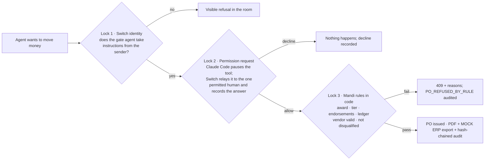
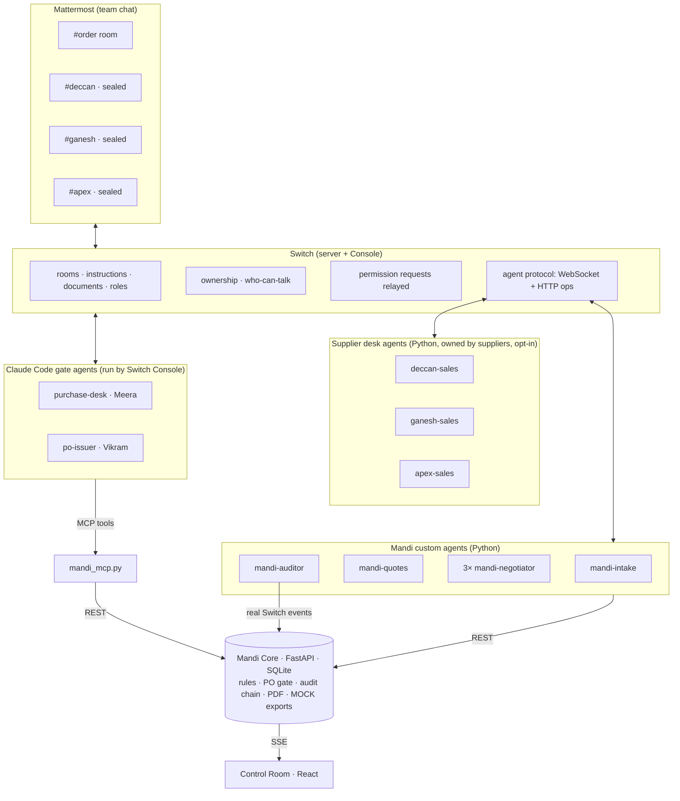

# Mandi <sub>मंडी</sub>: the purchase back-and-forth, in team chat

**Quotes, the comparison, the haggling and the sign-offs between purchase and finance happen in one Switch workspace, with AI agents doing the legwork. Every rupee still needs a human's tap to move, and the deal ends as a PO ready for your ERP.**

*Agents negotiate. Humans decide. Switch records who said yes.*

Built for the **Flip the Switch** hackathon (WeMakeDevs × DevTools Academy, powered by [Switch](https://docs.switchagents.ai) by SandboxAQ) · Track 01: Best Business Workflow


> 🎬 **Demo video:** _link coming soon_ · 👀 **No setup?** [Two-minute look](#two-minute-look-no-switch-needed) · 📖 **Plain-English tour:** Control Room → *How it works*

---

## The problem

Divya works in procurement at an automobile manufacturer. Buying one part looks like this:

1. An engineer raises a requisition.
2. Purchase asks several vendors for quotes. They come back as PDFs in five layouts, with the catch on page 2.
3. Someone keys the comparison into the company's purchasing software by hand.
4. Then the **signatures go back and forth**: purchase, finance and other teams, by email and phone, with negotiation in between.
5. A PO is raised, and the parts are delivered to the plant.

Most of the pain is **inside the buyer's company**: steps 2 to 4 take days, and nobody can later explain *why* a vendor won. The ERP (Divya's company uses SAP) is the system of record and does its job well. The trouble is the human back-and-forth **before** the record exists.

**Mandi** runs that back-and-forth in team chat (Mattermost, through Switch). An engineer asks in the order room. Agents write the spec, open one **sealed room per supplier**, read every quote, catch the traps (a hidden 50,000-piece minimum, an expired quote, freight left out) and a **prompt-injection attack** hidden in a PDF, then negotiate in parallel using only **verified** competing offers. The **purchase head and finance each tap Allow** on a permission request from an agent only they can instruct. Mandi's code checks every rule once more, issues the PO and writes a **MOCK SAP-style PO export** for the system of record.

It works **buyer-first**: a supplier who only emails a PDF is handled like any other (Konkan Fasteners in the demo has no agent and no room). A supplier can opt in to a **supplier desk**, its own AI sales agent in its sealed room, owned by its own people.

| ₹62,000 saved (7.85%) | ≈2 min request to award | 3 traps caught | 1 prompt injection blocked | 2 human sign-offs, recorded in Switch | 1 supplier-side "no" |
|---|---|---|---|---|---|

*(All companies, people, quotes and prices are fictional: Sahyadri Motors, Deccan Bolt Works, Shree Ganesh Fasteners, Apex Precision Components, Konkan Fasteners.)*

## Two-minute look (no Switch needed)

Replay mode drives the full scenario through Mandi Core so you can explore the Control Room. You need **Python 3.11+** and **Node 20+**. No Switch, Docker, Mattermost or API key. The UI is marked **Replay mode**, and every simulated chat line is labelled *simulated*.

macOS / Linux:

```bash
git clone https://github.com/NamanChordia07/mandi-switch.git && cd mandi-switch
python3 -m venv .venv && .venv/bin/pip install -r requirements.txt
.venv/bin/python scripts/init_env.py && .venv/bin/python seed/make_quotes.py
(cd ui && npm ci && npm run build)
.venv/bin/python scripts/run_all.py --core-only
```

Then, in a second terminal in the same folder:

```bash
.venv/bin/python scripts/simulate.py
```

Windows PowerShell:

```powershell
git clone https://github.com/NamanChordia07/mandi-switch.git; cd mandi-switch
python -m venv .venv; .venv\Scripts\pip install -r requirements.txt
.venv\Scripts\python scripts/init_env.py; .venv\Scripts\python seed/make_quotes.py
cd ui; npm ci; npm run build; cd ..
.venv\Scripts\python scripts/run_all.py --core-only
```

```powershell
.venv\Scripts\python scripts/simulate.py
```

Open **http://127.0.0.1:8700** while it runs (about 80 seconds; `--fast` takes about 12). You'll see the spec, the quote comparison with traps, the injection reveal, the negotiations, the approvals, the PO PDF, the MOCK exports and the Outcome card. In replay mode the two approvals are made with the gate agents' tokens. In the real demo they happen only when Meera and Vikram tap **Allow** in Mattermost.

## Stage map

Where Mandi sits in a purchase, and what is built today. The same map is in the Control Room under *How it works*.

| # | Stage | Status | What Mandi does |
|---|---|---|---|
| 1 | Requisition approval | 🛣️ Roadmap | Today the requester confirms the drafted spec in chat. A manager approving the requisition is not built. |
| 2 | RFQ and quotes | ✅ Built | One sealed Switch room per supplier; PDF quotes read with evidence for every value; traps and prompt injection caught. PDF-only suppliers work too. |
| 3 | Comparative statement | ✅ Built | Landed-cost comparison with a recommendation written by code, saved as a room document; **MOCK** CSV export. |
| 4 | Negotiation | ✅ Built | Parallel, in sealed rooms, citing only verified offers and never naming a rival. Supplier agents are opt-in. |
| 5 | Sign-off chain | ✅ Built | Value tiers; purchase head, then finance, each allow a permission request. Optional chaser: a reminder in the order room, then an escalation to a named person (off by default, `MANDI_CHASER=1`). |
| 6 | Purchase order | ✅ Built | PO PDF after the rules check again; **MOCK** SAP-style PO export (JSON/CSV). Not an SAP integration. |
| 7 | Delivery receipt | 🛣️ Roadmap | Goods receipt at the plant and closing the order. |

## Screens

| A supplier's sealed room in Mattermost (Asha sees only this room; she declines going below her line) | The order room: PO PDF, Outcome card, and a **visible refusal** when Rohan tries to instruct `@po-issuer` |
|---|---|
|  |  |

| Quotes normalised, traps caught | Prompt injection revealed | Two humans sign off in Switch |
|---|---|---|
|  |  |  |

**What Switch actually posted in the live run** (Mattermost, 6 Nov 2026):

> **PO Issuer (Vikram)** · `@vikram` **Permission needed** · request `A2` · mandi wants to run `issue_po` `{"order_id":"SM-PR-2026-0147"}` → **[1. Allow once] [2. Allow for this session] [3. Decline]**
> **PO Issuer (Vikram)** · **Allow once** · request `A2` · mandi wants to run issue_po · *Chosen by @vikram from Mattermost.*
> **PO Issuer (Vikram)** → `@rohan` *You're not permitted to direct messages to me in this room — my operator has restricted who can address me here.*
> **Switch** · `!roles` → **po-issuer** *(exclusive)* — 🟢 held by PO Issuer (Vikram)

---

## How Switch is used

> **Without Switch, Mandi has no sealed rooms, no agents owned by other companies, no way to route a sign-off to exactly one person, and no shared record. It stops working.**

What each part does on the money path, precisely:

- **Switch decides who can instruct each gate agent.** `purchase-desk` takes messages only from Meera and `po-issuer` only from Vikram. Agents can't instruct them, Mandi's own included, and neither can their operator.
- **Claude Code's provider permission is the actual gate.** The gate agents are Claude Code agents whose one money tool (`endorse_order`, `issue_po`) always asks for permission before it runs.
- **Switch relays that permission request** into the order room as Mattermost buttons, lets only the people the agent takes messages from answer it, and **records who answered**.
- **Mandi Core checks the rules once more** before anything is issued (Lock 3 below).

| Mandi capability | Switch feature | Where in the code |
|---|---|---|
| One workspace per order + one **sealed room per supplier** | **Rooms** bound to Mattermost channels (private channels for suppliers, private read/write visibility); membership decides which events an agent receives. `scripts/doctor.py` fails if a supplier room isn't sealed. | `scripts/bootstrap_switch.py`, `common/sealed.py` |
| Agents from **different companies** in one negotiation | **Agent ownership** via per-owner registration keys; several agents with different owners in one room | `scripts/register_agents.py`, `config/agents.yaml` |
| Suppliers can't instruct buyer agents and vice versa | **Who can talk to your agent** (scoped addressing policies) + **visible refusals** | `bootstrap_switch.py → policy_plan()` |
| Purchase head and finance sign-offs | **Permission requests** relayed from Claude Code gate agents (Allow once / for this session / Decline) as Mattermost **buttons**; only the people the agent takes messages from can answer; Switch records who did | `agents/gates/*`, `mcp_server/mandi_mcp.py` |
| Only one agent can ever issue a PO | **Exclusive role** `po-issuer` | bootstrap (`define_role … exclusive=True`) |
| Spec, comparison, negotiation logs, PO, exports and audit log live with the work | **Room documents** + media attachments | `upsert_doc()` in `agents/switchclient/client.py` |
| Every agent knows each room's rules | **Room instructions** | `config/room-instructions/*.md` |
| Quotes travel through the sealed room | Agent **media upload/download** | vendor agents, negotiator |
| Handoffs between agents | **Mentions / targeted messages** | all agents |
| Live dashboard fed by real chat | **Agent protocol** WebSocket, `scope=all, filter=all` | `agents/auditor/agent.py` → Control Room |
| Operators can inspect | **Room commands**: `!list-agents`, `!roles`, `!list-documents`, `!agents-status` | demo |

### The key insight: in Switch, *who an agent listens to* is *who can answer its permission requests*

Switch's docs: *"Anyone the agent takes messages from can answer its requests."* So each gate agent takes messages from **exactly one human**: `purchase-desk` from Meera, `po-issuer` from Vikram. No agents, not even Mandi's own, and not their operator. A compromised Mandi agent therefore can't get a sign-off answered. Meera types `@purchase-desk endorse`, the agent prepares a 4-line summary and calls its tool, Claude Code pauses for permission, and Switch puts the request in front of *Meera*.

## Three locks on the money



Prompts aren't security; code is. Even if an agent were fooled by the injected PDF (try **Director → "Fooled agent calls issue_po for Apex"**), Mandi Core refuses with five reasons.

## Where SAP fits (MOCK exports)

SAP (or whichever ERP a company runs) stays the **system of record**. Mandi is a chat-native front end for the back-and-forth that happens **before** the record exists, and it ends by handing over the agreed deal:

- **Comparative statement** (`06-comparative-statement-MOCK`, CSV): the comparison form for the file. One row per vendor with quoted terms, landed cost, traps found, last negotiated offer and the award. Similar in spirit to an ERP's price comparison list.
- **SAP-style PO** (`05-po-sap-style-MOCK`, JSON + CSV): header data (PO number, vendor, purchasing organisation, purchasing group, plant, currency, document date) and item data (item, material, short text, quantity, unit, net price, price unit, delivery date), shaped like the purchase-order data a buyer keys into SAP MM.

Both are saved as order-room documents and uploaded to the room after the PO PDF, and they can be downloaded from the Outcome card or `GET /orders/{id}/exports/...`. **They are mocks, not an SAP integration.** The field names and the SAP-style labels in the export are illustrative and **unverified**, so a procurement colleague should validate them. All codes are fictional and set in `config/scenario.yaml → po_export`. `MANDI_EXPORTS=0` switches them off.

## Architecture



Full walkthrough with sequence diagrams: **[docs/architecture.md](docs/architecture.md)**.

## The cast

| Agent | Kind | Owner | Room(s) | Who can talk to it | Can it move money? |
|---|---|---|---|---|---|
| `mandi-intake` | custom (Python) | Mandi Exchange | order | Rohan, Meera, Vikram, Mandi agents | no |
| `mandi-quotes` | custom | Mandi Exchange | order | buyer team, Mandi agents | no |
| `mandi-negotiator-{deccan,ganesh,apex}` | custom | Mandi Exchange | one sealed room each | that supplier's agent + person | no; every message checked by Core |
| `mandi-auditor` | custom, listen-only | Mandi Exchange | all | owner only | no |
| `deccan-sales` / `ganesh-sales` / `apex-sales` | custom (supplier desk) | **Asha / Sanjay / Karan** | own sealed room only | own person + Mandi's negotiator | below its line only with its owner's OK |
| `purchase-desk` | **Claude Code**, managed agent run by Switch | operator account; **acts for Meera** | order | **Meera only** (no agents, not even its owner) | `endorse_order` → Claude Code asks; Switch relays to Meera |
| `po-issuer` | **Claude Code**, managed agent run by Switch, exclusive role `po-issuer` | operator account; **acts for Vikram** | order | **Vikram only** | `issue_po` → Claude Code asks; Switch relays to Vikram; then Core checks |

Ownership is real: `deccan-sales`, `ganesh-sales` and `apex-sales` were registered with registration keys created **by Asha's, Sanjay's and Karan's own Switch accounts**, so Switch lists those people as the owners. The two gate agents run on the operator's machine, so the operator owns them, but their addressing policy excludes the owner: only the one approver can instruct them, and therefore only that approver can answer their permission requests.

---

## Full setup (live, with Switch)

**Prerequisites:** Windows 11 / macOS / Linux · Python 3.11+ · Node 20+ · **Docker Desktop** (Switch's bundled Mattermost runs in Docker) · **Switch Console 0.40+** · Claude Code installed and signed in (it powers the two gate agents) · an **OpenAI API key** for the custom agents' wording and evidence-checked extraction (a full run costs about one US cent with `gpt-4o-mini`; `MANDI_OFFLINE_LLM=1` runs without it, using template wording).

Do the [two-minute look](#two-minute-look-no-switch-needed) install first (venv, `init_env.py`, quotes, UI build), then:

```bash
.venv/bin/python scripts/setup_gates.py      # MCP config for the two Claude Code gate agents
```

(On Windows use `.venv\Scripts\python` in every command below.) Paste your `OPENAI_API_KEY` into `.env`. Then set up Switch once. It takes three clicks in Switch Console; everything else is scripted ([docs/manual-setup.md](docs/manual-setup.md) has the details):

1. **Switch Console** → *Get started* → *On this computer* → *Start*. Console 0.40 runs the server natively (Python + bundled PostgreSQL).
2. **Power switch-buddy with Claude Code** (switch-buddy chat → *Connect an AI provider* → Claude Code). This enrols your computer as the machine that runs Claude Code agents.
3. **Admin → Status → Mattermost → on**, then **Restart**. Mattermost now runs in Docker beside the server and is connected.
4. In `.env`, set `SWITCH_BASE_URL` (Console picks the ports; on Windows see `%APPDATA%\switchdash\local-switch-server\ports.json`), the Gateway admin login (`SWITCH_ADMIN_EMAIL` / `SWITCH_ADMIN_PASSWORD`), `MATTERMOST_URL`, `MATTERMOST_TEAM=switch` and `MATTERMOST_CONTAINER`. The next script creates the registration keys (`REGKEY_*`) for you.

```bash
.venv/bin/python scripts/setup_switch_accounts.py   # Switch accounts for Asha/Sanjay/Karan + a registration key per owner
.venv/bin/python scripts/create_personas.py         # Rohan, Meera, Vikram, Asha, Sanjay, Karan in Mattermost (mmctl --local)
.venv/bin/python scripts/register_agents.py         # 9 custom agents, each registered with its OWNER's key
.venv/bin/python scripts/create_gate_agents.py      # purchase-desk + po-issuer as managed Claude Code agents (asks first)
.venv/bin/python scripts/bootstrap_switch.py        # 4 rooms + channels, instructions, exclusive role, addressing policies
.venv/bin/python scripts/doctor.py                  # every check green, including "Sealed supplier rooms"
```

Run:

```bash
.venv/bin/python scripts/run_all.py   # Mandi Core + 9 agents; Control Room at http://127.0.0.1:8700
```

## Run the demo yourself

Open four browser windows (`scripts/open-demo-windows.ps1` does it with separate profiles): Mandi Control Room, Mattermost as **Rohan**, as **Asha**, and as **Meera/Vikram**.

1. **Rohan** posts in the order room: `@mandi-intake hey team, need seat bolts for the new rear bench line…` → replies `yes` to the spec.
2. Watch the sealed rooms open, quotes arrive as PDFs, and the traps and the injection appear in the Control Room.
3. **Asha** gets `🔒 Approval needed` in the Deccan room → replies `decline`.
4. **Meera**: `@purchase-desk endorse SM-PR-2026-0147` → taps **Allow once** on the permission request.
5. **Vikram**: `@po-issuer release the PO` → taps **Allow once** → the PO PDF and the MOCK exports land in the room, the Outcome card posts, and `!list-documents` shows the record.

Red-team (Director drawer, `D`): *fake leverage* (blocked before it reaches the supplier) and *fooled agent issues a PO for Apex* (refused by rule). Script and timing: **[docs/demo-script.md](docs/demo-script.md)**.

## Tests

```bash
.venv/bin/python -m pytest                  # 71 tests, offline: no Switch, no LLM calls
.venv/bin/python tests/run_fake_e2e.py      # the REAL 9 agents end-to-end against a protocol stub (no Docker); add --chaser to test the sign-off chaser
.venv/bin/python scripts/simulate.py --fast # end-to-end through Mandi Core's HTTP API (needs Core running)
.venv/bin/python scripts/live_rehearsal.py  # LIVE: plays Rohan/Asha in Mattermost; waits for a HUMAN to tap Allow
```

Covered: Indian money formatting, every trap, ranking and tie-breaks, tier boundaries (₹49,999 / ₹50,000 / ₹5,00,000 / ₹5,00,001), illegal state transitions, leverage verification (verified, fabricated, expired, disqualified, competitor named, number smuggled in text), every PO-gate check, audit-chain tampering and deletion, vendor token scoping, sealed-room rules (room plan, live membership, addressing plan, Mattermost channel type), the MOCK exports, the sign-off chaser, the full scenario, the decline path, and the Switch client's ping/pong, resume and `taken_over` handling.

## Security notes

- **Prompt injection:** supplier PDFs are scanned for hidden text (tiny fonts, white-on-white, off-page, metadata, annotations), English + Hinglish patterns, and an LLM classifier that reads the text *as data*. LLM extractions must quote evidence that Core finds in the document, or the value is rejected.
- **Verified leverage & sealed bids:** Core checks every outbound negotiator message *before* it reaches Switch. Claimed rival prices must match a valid, non-disqualified, comparable offer (±₹0.01); competitor names and unbacked rupee amounts are blocked.
- **Sealed rooms:** supplier rooms are private channels with private visibility; `doctor.py` fails if the room plan, the live membership, the addressing plan or the Mattermost channel type says otherwise.
- **PO gate:** caller identity, state, tier endorsements, accepted award, vendor status, quote validity, ledger arithmetic, no duplicate PO.
- **Audit trail:** append-only, SHA-256 hash-chained; the PO PDF carries the final hash.
- **Secrets:** `.env` and `secrets/*.local.json` are git-ignored; vendor agents load only their own rules file and get a vendor-scoped Core token.
- **Agents' powers:** "Can manage agents" and "Bypass permissions" stay off; gate agents deny shell/file/web tools.

**Real vs simulated.** Real: Switch rooms, agents, ownership, addressing policies, relayed permission requests, room documents, Mattermost. Simulated: the companies, people, quotes and prices (all fictional). Mocks: the SAP-style PO export and the comparative statement (no ERP is connected). The supplier-side approval uses a Switch room message whose **sender identity Switch provides** (we check it), not a permission request; see *Limitations*.

## Limitations and roadmap

- **Category profiles (roadmap).** The engine today is built around one category (fasteners: grade, finish, MOQ, lead time, landed cost per piece). Real purchases also span sheet metal, plastics (mould cost and ownership), ADAS sensors (certification, firmware, end-of-life risk) and hardware + SaaS (device price plus a subscription over the contract term, auto-renew escalators). The plan is a **category profile** in config, not code: spec attributes, a cost model (landed cost or total cost of ownership) and per-category trap rules.
- **Requisition approval** and **delivery receipt** (stages 1 and 7) are not built. The **sign-off chaser** is built but off by default and only posts messages; it doesn't yet page anyone outside the order room.
- **No real SAP or Ariba integration.** The exports are mocks shaped like ERP purchase-order data.
- Supplier-side approval is a message-based fallback (sender verified via Switch); the next step is a Claude Code "desk" agent per supplier so it becomes a relayed permission request too.
- The two gate agents are owned by the operator account (Console can only run agents on the signed-in owner's machine); the addressing policy, not ownership, restricts them to Meera and Vikram.
- Switch Console on Windows is early access; what we hit (Virtual Machine Platform, Docker's first boot, protocol quirks) is in [docs/switch-notes.md](docs/switch-notes.md).
- Single plant, single currency, GST excluded, invented approval thresholds. Also roadmap: real supplier onboarding with their own Switch servers, reverse auctions, Switch Trust guardrails on all LLM calls, multi-currency.

## Built during the hackathon · Team

Built 4–7 Nov 2026 for Flip the Switch. **Naman Chordia** (automation engineer) and **Divya** (procurement insight from the automotive floor; plays Meera and the supplier owners in the demo).

Credits: [Switch](https://github.com/sandbox-quantum/switch) by SandboxAQ · WeMakeDevs · DevTools Academy · Noto Sans (SIL OFL) · Geist. Mandi's own code is MIT-licensed (see `LICENSE`); Switch has its own license.
