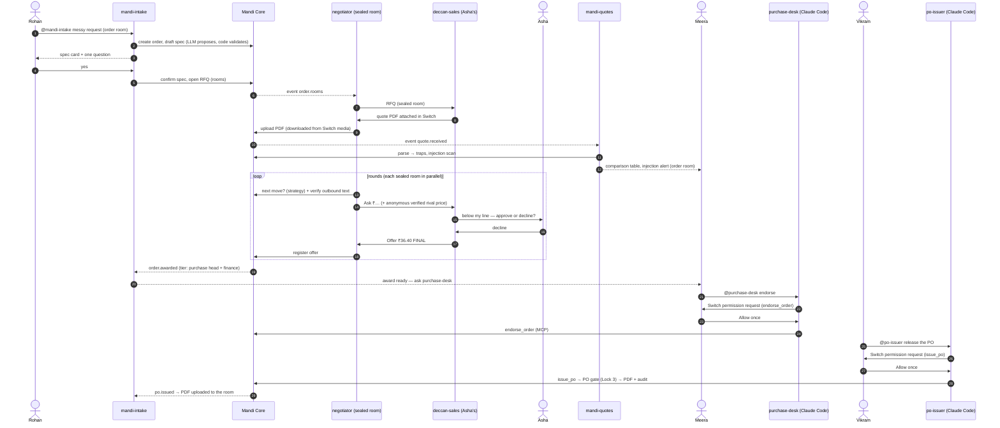

# Mandi — architecture (explainable end to end)

This document is written so Naman and Divya can explain every part of Mandi to a judge.

## 1. Components

| Component | Tech | Runs where | Job |
|---|---|---|---|
| **Switch server + Mattermost** | Switch (SandboxAQ), Docker | started by Switch Console | rooms, identity, addressing, permission requests, documents, roles, agent protocol |
| **Mandi Core** | Python 3.12, FastAPI, SQLite (SQLModel) | `:8700` | the rules: state machine, quote parsing + traps + injection scan, comparison, negotiation strategy, verified leverage, approval tiers, PO gate, PO PDF, hash-chained audit, event stream |
| **Custom agents** (9) | Python asyncio + our `switchclient` | `scripts/run_all.py` | talk in Switch rooms; call Core for every decision |
| **Gate agents** (2) | Claude Code, run by Switch Console | Console / agent controller | the only path to money: one MCP tool each; Claude Code asks permission, Switch relays the request to one human and records the answer |
| **Mandi MCP server** | `mcp` SDK (stdio) | started by Claude Code from `.mcp.json` | exposes Core to the gate agents (read tools + one gated tool per profile) |
| **Control Room** | React 19, Vite, Tailwind 4, Motion, Recharts | served by Core at `/` | live explainer for judges: stages, rooms, quotes, price ladder, approvals, outcome, audit |

## 2. Data model (Core)

Money is **integer paise** everywhere (₹36.40 → 3640). Tables: `orders`, `vendors`, `quotes`, `offers` (append-only
negotiation ledger), `approvals`, `purchase_orders`, `audit` (hash chain), `switch_feed` (real room traffic from the auditor).

Order states (illegal moves raise `IllegalTransition`):

```
DRAFT → SPEC_CONFIRMED → RFQ_OPEN → QUOTES_RECEIVED → COMPARED → NEGOTIATING → NEGOTIATION_CLOSED → AWARDED
      → ENDORSED_PURCHASE_HEAD → ENDORSED_FINANCE → PO_ISSUED
(AWARDED → NEGOTIATION_CLOSED when Meera declines; AWARDED → PO_ISSUED only for the auto tier)
```

## 3. The flow



## 4. Why each piece exists

- **Core decides numbers; LLMs write words.** The buyer strategy (`core/negotiation.py`) computes target =
  min(verified rival − ₹0.50, best valid quote × 0.92), opens ₹1.20 below, concedes ≤ ₹0.40/round, max 4 rounds.
  Vendor agents run `vendor_move()` with their own secret ladder/line/floor. Wording goes through `wordsmith()`,
  which rejects any rephrasing that changes a rupee amount or a mention.
- **Every outbound negotiator message is verified before it reaches Switch** (`core/leverage.py`): rival price claims
  must match a current, comparable, non-disqualified offer from another vendor; competitor names and any rupee
  amount not backed by the ledger are blocked.
- **Messages carry a machine line** (`Offer: ₹38.20/pc delivered · 20,000 pcs · FINAL`, `Ask: …`) written by code;
  the receiving agent parses that, never the prose.
- **Quotes travel through Switch**: the vendor agent uploads its PDF to its sealed room (`POST /agents/{id}/rooms/{room}/media`);
  the negotiator downloads it (`GET …/media?mxc=`) and hands it to Core.
- **Extraction is evidence-checked**: the LLM must quote the snippet each value came from; Core searches the document
  for that snippet and the value inside it; otherwise the deterministic extractor's value (or "missing") is used.
- **Injection scan**: hidden text (≤3 pt, white-on-white not on a dark fill, off-page, annotations, metadata) +
  weighted patterns (EN + Hinglish) + an LLM classifier on suspicious chunks only.
- **Gate agents answer one human each.** In Switch, the people an agent takes messages from are exactly the people who
  can answer its permission requests. So `purchase-desk`'s policy admits only Meera's Mattermost identity; `po-issuer`
  only Vikram's — no agents, no owner.
- **Auditor** uses `scope=all, filter=all` to stream every room event into Core; the Control Room's chat mirror is real
  Switch traffic. A second single-room connection posts the Outcome card and writes the audit log document.

## 5. Switch protocol client (`agents/switchclient`)

- One WebSocket per agent: `GET /agents/{id}/connection/ws?connection_id=…&rooms=…&scope=…&filter=…`.
- **Pings answered from the reader task immediately** (`{"type":"pong","cursor":N}`); events go to a queue processed by
  a worker, so slow handlers never starve the heartbeat.
- `connection_id`, cursor and generation persist in `.state/<agent>.json`; reconnect with `start_from` +
  `expected_generation` on `heartbeat_lapsed`/`no_stream`/`unfenced`/`connection_error`; stop on `taken_over`.
- Ops: discovered from `GET /agents/{id}/ops`, arguments checked against the live schema, called with
  `X-Switch-Connection-Id`. Helpers: `post`, `targeted`, `read_context`, `upsert_doc`, `upload`, `download`, `typing`.

## 6. LLM use and budget

OpenAI `gpt-4o-mini`, temperature 0, strict JSON schema outputs. Every call is cached on disk (`.state/llm-cache/`),
capped per process (`MANDI_LLM_MAX_CALLS`), and logged with an estimated cost (`logs/llm-usage.jsonl`). A full run is
≈ 25 calls ≈ US$0.01; rehearsals with the same inputs are free. `MANDI_OFFLINE_LLM=1` runs fully deterministic.

## 7. Files to read first

`core/service.py` (all operations), `core/po.py` (Lock 3), `core/leverage.py`, `core/negotiation.py`,
`agents/negotiator/agent.py`, `agents/vendors/common.py`, `scripts/bootstrap_switch.py` (`policy_plan`),
`mcp_server/mandi_mcp.py`, `agents/gates/*/CLAUDE.md`.
